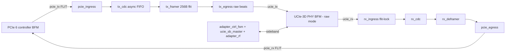

# pcie-on-ucie-3d

A synthesizable **PCIe ⇄ UCIe-3D raw-mode adapter** that tunnels **PCIe 6 256-byte
FLITs** over a **UCIe-3D** vertical die-to-die bump interface, verified in **five
independent DV environments** that cross-check against one Python golden model.

**Baseline:** UCIe **3.0** (Aug 2025) UCIe-3D — vertical stacking, hybrid-bonding
bump pitch, **no D2D adapter**, **raw mode** (the protocol owns CRC/retry); PCIe side
= PCIe 6 256B FLIT mode; 64 GT/s (Gen) baseline, datapath speed-parametric. See
[`docs/ucie3d_notes.md`](docs/ucie3d_notes.md).

> **Status — M2 Rx datapath + C1 loopback (2026-10-18).** `make regress` GREEN:
> Verilator `--lint-only -Wall` (default + `FLOW_CTRL_OVERRIDE` + `DP_RESET_DISABLE`,
> x8 refused) + Icarus `make sim` — `tb_smoke` reset/defaults, `tb_tx`
> (**115 frames → 512 flits**) and `tb_loop` (C1 loopback: **115 frames round-tripped
> byte-exact, Rx error counters all 0**). Both datapaths are live (Tx: async FIFO →
> framer → egress; Rx: flit-lock → deframer → async FIFO → egress); the control plane
> (M3) is stubbed. Five env smokes pass; `dv/common` golden-model spine in place;
> CI/Docker/Railway + both agent swarms + docs authored. **Local repo only — no
> remote.** Roadmap + open items: [`docs/PLAN.md`](docs/PLAN.md) §11,
> [`docs/OPEN_DECISIONS.md`](docs/OPEN_DECISIONS.md).

## What this adapter does
PCIe flits enter on an AXI4-Stream-like interface, cross into the UCIe clock domain,
are packed into 256-byte flits, and are serialised over a wide raw-mode parallel bump
bus; the reverse path reassembles them. A small control FSM brings the link up and
sequences L0/L1/L2 and speed/width changes over an 8-bit UCIe **sideband**.



```mermaid
stateDiagram-v2
  [*] --> ST_RESET
  ST_RESET --> ST_SBINIT --> ST_MBINIT --> ST_PARAM --> ST_ACTIVE
  ST_ACTIVE --> ST_DRAIN
  ST_DRAIN --> ST_SPEED_CHG --> ST_ACTIVE
  ST_DRAIN --> ST_WIDTH_CHG --> ST_ACTIVE
  ST_DRAIN --> ST_LOWPWR
  ST_LOWPWR --> ST_PWR_CHG --> ST_ACTIVE
```

## Quick start
```
make regress        # lint + Icarus smoke — the fast CI gate
make iverilog vlt systemc cocotb uvm    # the five DV env smokes
make coverage       # Verilator --coverage -> coverage.info
make ci             # regress + coverage + formal + envs + crosscheck
python3 dv/common/scenarios.py          # the golden expectations
python3 playground/assemble.py          # (re)build the EDA Playground bundle
```
Tools (no OSS CAD Suite) are pinned in the [`Dockerfile`](Dockerfile); see
[`docs/TOOLCHAIN.md`](docs/TOOLCHAIN.md). Verilator-based flows run in a container
(GitHub Actions / Railway).

## The three testbench configs
- **C1 — PCIe on UCIe-3D only**: integrated adapter, UCIe Tx looped to Rx (all 5 envs).
- **C2 — PCIe back-to-back**: two PCIe endpoints direct (PCIe layer in isolation).
- **C3 — UCIe-3D back-to-back**: two UCIe-3D PHYs at the bumps (raw-mode link in isolation).

## Layout
```
rtl/   dv/{iverilog,vlt,uvm,systemc,cocotb,common,sva,waves,random}   formal/  lp/
metrics/  playground/  docker/  .claude/agents/  .github/workflows/  docs/
```

## Workspace conventions
Inherits [`~/proj/CLAUDE.md`](../CLAUDE.md) and [`~/proj/DV_STANDARDS.md`](../DV_STANDARDS.md);
tools pinned in the Dockerfile (no OSS CAD Suite). `rtl/` stays assertion-free (SVA
via `bind` in `dv/sva/`). Two AI agent swarms live in `.claude/agents/`
([index](.claude/agents/README.md)).
